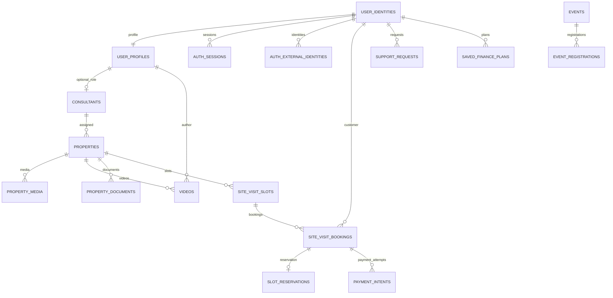
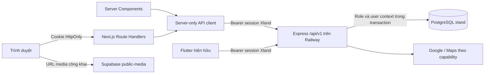

# Kế hoạch tích hợp xland-server vào website Xland

> Ngày phân tích: **22/10/2026**, múi giờ Asia/Ho_Chi_Minh. Phạm vi thực hiện của phiên này: khảo sát chỉ đọc và lập kế hoạch; chưa thay mã ứng dụng, cấu hình triển khai hoặc dữ liệu nghiệp vụ.
>
> Kết luận: **cấu trúc lại website theo domain và hợp đồng API của xland-server, giữ hệ thống giao diện hiện có**. Dùng chung backend với Flutter. Có thể nối dữ liệu, tài khoản và nhiều hành trình ngay sau các bước chuẩn hóa; chưa thể vận hành thanh toán, NFT, đăng bán hay đầy đủ vòng đời lịch xem bằng backend hiện tại.

## 1. Căn cứ, mức độ xác minh và cách sử dụng kế hoạch

### 1.1. Nguồn đã kiểm tra

| Nguồn | Mốc đối chiếu | Đã kiểm tra |
| --- | --- | --- |
| Website `D:/Xproject/Xland` | HEAD `27f03ee966f70f0dee3302a443951d5c242ca448` | PREPARE, STATUS, route/component, fixture, journey/NFT store, query, cấu hình Next.js, package và test |
| Server `D:/Xproject/xland-server/xland-server` | HEAD `1c01f544efabb128c0785a99aa15f1c2954926b7` | Router, validation Zod, service, repository, auth, maps, sharing, SQL migration, test và tài liệu release |
| PostgreSQL trên Supabase, lấy kết nối từ `.env` server | 11:48–11:49 ngày 22/10/2026 | Catalog hệ thống, 41 bảng `xland`, cột/constraint/index/policy/grant/function, migration ledger, số lượng và trạng thái tổng hợp |
| API Railway đang hoạt động | 11:48 ngày 22/10/2026 | 26 GET: 15 HTTP 200, 6 HTTP 400, 3 HTTP 404, 2 HTTP 401; lỗi gồm probe hợp đồng cố ý và lỗi rollout tác giả |
| Next.js đang cài | `16.3.6`, React `19.2.8` | Hướng dẫn local về fetching, Route Handlers, cookies, BFF và authentication |

Các file `.env*` chỉ được đọc trong tiến trình khảo sát. Không đưa URL kết nối database, mật khẩu, token, khóa Supabase/Google/SMS/maps hoặc dữ liệu liên hệ vào tài liệu. Kết nối PostgreSQL ép `default_transaction_read_only=on`, truy vấn trong transaction chỉ đọc và rollback. Không đăng nhập, không gọi mutation, không chạy seed/migration/provisioning/smoke có ghi dữ liệu. Không gọi `area-map`/tiles vì GET này có thể ghi cache, quota và gọi nhà cung cấp.

**Không đồng nhất ba lớp bằng chứng:** có code, có cấu trúc DB, và endpoint đã chạy đúng là ba điều khác nhau. Những mutation được mô tả dưới đây đã đọc code, chưa được thử lại trong phiên này. Không tuyên bố “chính xác tuyệt đối” trước khi qua contract test, kiểm thử quyền và nghiệm thu web–Flutter trên staging.

Phụ lục dùng khi triển khai:

- [Danh mục 70 operation API, request và quy tắc wire](integration/API-CONTRACT-2026-10-22.md).
- [Snapshot schema trực tiếp: 41 bảng, quan hệ, constraint, index, RLS](integration/SCHEMA-SNAPSHOT-2026-10-22.md).
- [PREPARE](../PREPARE.md), [STATUS](STATUS.md), [quy tắc media](ASSETS.md), [UI-UPGRADE](UI-UPGRADE.md). Kế hoạch này bổ sung lộ trình tích hợp theo yêu cầu mới; không đánh dấu hoàn tất 1B/P09 hoặc tự phê duyệt triển khai ví/admin.

### 1.2. Giới hạn hiện tại phải đưa vào backlog

- Bản server đang checkout không có `node_modules`. Các bộ test server còn tham chiếu `../brain` và `../xland-mobile`; hai thư mục đó không có trong bản sao đang khảo sát. Chưa chạy build/test server; phải khôi phục bộ contract/fixture hợp lệ hoặc tách test khỏi đường dẫn workspace trước khi dùng làm CI gate.
- Tài liệu `BOOTSTRAP.md` còn mô tả chỉ có healthcheck; README cũng chứa các mốc cũ. Router/service/DB và kiểm tra HTTP ngày này là căn cứ hiện trạng; không dùng riêng tài liệu lịch sử để kết luận tính năng thiếu hoặc hoàn tất.
- Các thay đổi sẵn có của chủ dự án được giữ nguyên, gồm tài liệu/assets/scripts website và `.env.example` server.
- `pnpm check` website trong phiên này **dừng tại lint**: `assets/brand/xland-mam-dat-final/build.cjs` có 3 lỗi `no-require-imports` và 1 warning unused `px`. Typecheck/unit/build/E2E phía sau chưa chạy trong lượt này. Không sửa asset ngoài phạm vi để làm xanh gate. Lịch sử STATUS còn các lỗi WebKit; phải xử lý và kiểm lại ở mốc triển khai.

## 2. Hiện trạng backend và quyết định phạm vi

### 2.1. Kiến trúc thực tế

Server là **Express 5 + TypeScript + Zod + `pg`**, không phải API REST sinh tự động từ Supabase. PostgreSQL/Supabase Storage đang được sử dụng; **xác thực là hệ thống riêng của Xland**, không phải Supabase Auth. `xland.user_identities`, `auth_sessions`, `auth_external_identities` là các bảng danh tính chính.

`Database.transaction()` chọn role nội bộ bằng `SET LOCAL ROLE`, đặt `xland.user_id` sau khi xác minh bearer rồi thực thi nghiệp vụ. Website phải đi qua API này. Không đưa `supabase-js`, service key hoặc `DATABASE_URL` vào web để tự CRUD các bảng.

| Hạng mục | Kết quả thực tế | Hệ quả cho website |
| --- | --- | --- |
| Health/readiness | Đều 200 tại thời điểm probe | Có thể kết nối API, chưa chứng minh mọi nghiệp vụ đã triển khai |
| API nguồn | 70 tổ hợp method/path dưới `/api/v1` | Lập contract cho từng operation; route tồn tại vẫn có thể trả lỗi policy/provider |
| Danh mục | 20 property, 96 video, 118 media, 8 consultant, 5 event, 1 club | Xây web theo tập này, không nối bằng tên/slug của 10 fixture cũ |
| Dữ liệu tài sản | 20/20 `listed`, `approved`, `is_illustrative=true`; toàn bộ 118 media cũng illustrative | Backend thật đang phục vụ nội dung pilot. Không coi việc nối API là đã có nguồn hàng thật |
| Địa bàn | 15 property miền Bắc, 5 miền Trung; chưa có miền Nam/industrial trong tập hiện tại | Filter vẫn theo enum API; khu vực không có dữ liệu hiển thị empty state |
| PostgreSQL | 17.6; 41/41 bảng bật RLS + FORCE RLS | Giữ chính sách hiện có; cần kiểm thử quyền theo caller, không chỉ xem cờ bật |
| Migrations | 12 file SQL đã có trong `xland_meta.migrations`, digest khớp sau chuẩn hóa CRLF | Không cần tạo lại database để tích hợp; đây chưa phải phép chứng minh mọi DDL không drift |
| Runtime role trong DB | `xland_runtime_internal`, NOBYPASSRLS; thành viên api/auth/maps, không có payment | Duy trì tách runtime khỏi credential quản trị/migrate; chưa xác minh Railway Variables trong phiên này |
| Supabase API roles | `anon`, `authenticated`, `service_role` không có USAGE schema `xland` | Không thiết kế web theo JWT Supabase hoặc `auth.uid()` |
| Storage | Bucket `public-media`, public; 15.000.000 byte/file, MIME PNG/MP4 | Đây là nguồn media hiện hữu; không suy ra có upload API hoặc kho giấy tờ riêng |
| Auth capabilities | Password bật, Google bật, phone OTP tắt | Web cần Google OAuth client cho web và đăng nhập username nếu có tài khoản; không dựng đăng ký/reset mật khẩu chưa có API |
| Author profile | Code có; 3 author lấy từ feed đều GET profile 404, GET videos có `limit` trả 400 | Blocker rollout xác nhận trực tiếp; không dùng consultant thay author để che lỗi |
| Lịch/tiền | 9 booking, 9 payment `disabled/unpaid`, 8 reservation `hold` | Phải chốt xử lý giữ chỗ; không mở thu tiền hoặc tự xác nhận lịch |
| NFT/đăng bán/admin | Không có API/schema nghiệp vụ tương ứng | Tách khỏi phiên bản tích hợp, giữ kế hoạch phát triển riêng |

### 2.2. Phân kỳ sản phẩm

1. **Web kết nối backend pilot:** danh mục, chi tiết, đăng nhập, lưu, video, hỗ trợ, hồ sơ, cộng đồng và ước tính tài chính; dữ liệu vẫn theo chất lượng pilot. Booking/event write chỉ bật khi môi trường và quy trình xử lý phù hợp đã sẵn sàng.
2. **Web vận hành với khách hàng và nguồn hàng thật:** cần dữ liệu có quyền sử dụng, quy trình tiếp nhận/điều phối, chính sách giữ chỗ/đổi/hủy, quyền tài liệu, hỗ trợ và consent có lưu vết. Đây là gate riêng, không đạt chỉ vì có HTTP 200.
3. **Thanh toán/NFT/đăng bán/admin:** chương trình mở rộng backend, không gộp vào công việc thay adapter website. NFT vẫn là định hướng ERC-1155; backend hiện tại chưa có offering/order/holding/wallet/contract tương ứng.

## 3. Mô hình nghiệp vụ chuẩn để cấu trúc lại website

### 3.1. Các domain và quan hệ



Sơ đồ rút gọn để đọc nghiệp vụ; FK chính xác và nullable nằm trong snapshot. Các quan hệ tài khoản dùng chung UUID nhưng hồ sơ công khai không đồng nghĩa tài khoản được phép đăng nhập. Có 30 identity thiếu contact nhưng **không có identity active thiếu contact** ở thời điểm kiểm tra; không tự backfill chúng thành khách hàng.

| Domain | Bảng chính | Bất biến cần giữ |
| --- | --- | --- |
| Identity/account | user_identities, profiles, contacts, settings, roles; sessions/external identities/OTP/rate buckets | Không gộp tài khoản bằng email/điện thoại liên hệ; Google nhận diện bằng issuer + subject |
| Catalog | properties, geo_locations, property_media | UUID là định danh; `code` để hiển thị; approval khác sale status; giá/diện tích decimal string |
| Social | videos, likes, comments, follows, saved_videos | Author là người đăng; không suy ra chủ sở hữu hay consultant của property |
| Quan tâm | saved_properties, saved_events | State thuộc tài khoản, cùng một nguồn dữ liệu cho web và Flutter |
| Hồ sơ/khu vực | legal_items, documents, access_grants, nearby_amenities, map cache/quota | Verified chỉ theo từng mục kiểm tra; bản đồ cấp khu vực, không đại diện tọa độ thửa đất |
| Xem thực địa | slots, bookings, reservations, status_history | Slot là nguồn giờ/sức chứa; có lock và idempotency; pending không phải confirmed |
| Hỗ trợ | support_requests | `received`, chưa gán người tư vấn/SLA; `chat` là loại ticket, chưa có realtime chat |
| Community | consultants/reviews, clubs, events/registrations | Consultant có thể là author, author thường không phải consultant; đăng ký event chưa thanh toán |
| Finance | saved_finance_plans | Server tính lại theo giá hiện hành, khóa snapshot lúc lưu; bản cũ có thể `result=null` |
| Payment | intents, receipts, provider_events, status_history | Mode disabled/simulation/live; refresh chỉ đọc state, không xác minh chuyển tiền qua provider |
| Retry | idempotency_records | Cùng user + operation + key + body trả kết quả cũ; khác body bị conflict |

### 3.2. Chênh lệch bắt buộc sửa trong website

| Website hiện tại | Backend thực tế | Quyết định tái cấu trúc |
| --- | --- | --- |
| ID `XL-001`, slug fixture | UUID, `code`; không có slug lookup | Canonical `/lo-dat/[propertyId]` dùng UUID. Không tra theo title. Không tự map fixture sang record thật |
| Nhóm Đô thị/Vùng ven/Ocean Park/Vùng quê | category residential/industrial/agricultural/other | Bỏ bộ lọc nhóm fixture khỏi live. Nếu cần collection biên tập, thiết kế riêng sau, có mapping được quản trị |
| `region` là tên tỉnh/vùng tự đặt | regions north/central/south; provinceCode/districtCode từ catalog | Tách Miền – Tỉnh – Quận/huyện theo contract; không hard-code danh mục hành chính ngoài backend |
| `setting`, `kind`, `description` | Không có field tương ứng trong property DTO | Bỏ/ẩn khối thiếu dữ liệu; dùng `highlights` thực tế. Không suy `kind=Biệt thự` từ category residential |
| sort featured/price-asc/price-desc/area-desc | relevant/newest/price_asc/price_desc/area_asc | Đổi lựa chọn sort. `relevant` hiện thực tế là updated_at DESC; chưa phải ranking cá nhân hóa |
| Filter local trên toàn bộ fixture | Filter SQL + cursor | Query URL → serializer allowlist → API; không tải một trang rồi lọc/sort cục bộ như toàn danh mục |
| Giá/diện tích JS number | `numeric(20,0)` / `numeric(18,6)` trả string | DTO giữ string; tiền dùng BigInt khi cần số học; formatter decimal không mất chính xác |
| advisor object nhúng, có fixture ảnh | `consultantId` và endpoint consultant riêng | Load theo UUID, deduplicate trong request; placeholder trung tính khi thiếu ảnh; không gắn ảnh persona cũ |
| Save vào localStorage | PUT/DELETE saved, GET properties?savedOnly=true | State tài khoản, optimistic có rollback; không import local favorite có ID giả |
| Form chọn ngày/09:00/14:00, 1–8 người, persona cố định | availability → slotId, maxAttendees; contactName/Phone; transport/documents/loan flags | Viết lại form theo slot trả về; bỏ cửa sổ ngày cố định tháng 10 và persona |
| Lịch submitted/arranging/proposed/change_requested | awaiting_deposit, pending_confirmation, confirmed… | Dùng enum server, không ép bằng bảng ánh xạ làm sai ý nghĩa |
| Nút đổi/hủy chạy mô phỏng | Hai endpoint trả POLICY_NOT_CONFIGURED; availableActions rỗng | Disabled kèm lý do phù hợp, chỉ mở sau backend policy gate |
| Mua NFT/danh mục mock localStorage | Không có API/schema NFT | Live hiển thị “Tính năng sắp ra mắt”, không có mua/nắm giữ giả; bản demo cũ ở môi trường riêng |
| `/trai-nghiem` reset dữ liệu | Không có reset tài khoản/dữ liệu server | Không đưa reset demo vào bản live; đăng xuất chỉ revoke session hiện tại |

`listed` hiển thị “Đang giới thiệu”; `paused` là “Tạm dừng”; `sold` là “Đã bán”. Không đồng nhất `approved` với đã xác minh quyền sở hữu/pháp lý. `board_source` là nguồn nội dung, không phải chứng thư.

### 3.3. Routes và điều hướng đích

| Route web đề xuất | Nội dung / API nguồn | Phạm vi |
| --- | --- | --- |
| `/` | Hero/story giữ thiết kế; catalog chọn giới hạn; consultant từ các property đang hiển thị | Pilot lõi |
| `/lo-dat`, `/lo-dat/[propertyId]` | Search/count/catalog; detail/legal/area-map; consultant; availability | Pilot lõi |
| `/dang-nhap`, `/tai-khoan`, `/tai-khoan/cai-dat` | Capabilities/session/profile/settings | Pilot lõi |
| `/da-luu` | Tab property/video/event, mỗi tab gọi repository riêng | Property trước, tab khác theo phase |
| `/lich-hen`, `/lich-hen/moi?propertyId=…`, `/lich-hen/[bookingId]` | Availability → create → list/detail/history/payment state | Read trước; write có gate |
| `/ho-tro`, `/ho-tro/yeu-cau` | Form theo property/consultant; danh sách ticket | Pilot lõi |
| `/video`, `/video/[videoId]` | Feed, deep link, like/save/comment/share | Phase social |
| `/nguoi-dang/[authorId]` | PublicAuthor + video do chính người đó đăng | Sau deploy author fix |
| `/chuyen-vien/[consultantId]` | Consultant, property, video, review, availability | Phase social |
| `/dang-theo-doi` | Danh sách author đã follow | Phase social |
| `/su-kien`, `/su-kien/[eventId]`, `/tai-khoan/dang-ky-su-kien` | Event, saved, registration | Phase community |
| `/cau-lac-bo`, `/cau-lac-bo/[clubId]` | Nội dung club; không tự thêm join/membership | Phase community |
| `/ke-hoach-tai-chinh`, calculator tại detail | Estimate, save/list/delete plan | Phase finance |
| `/nft` | Nội dung giới thiệu, trạng thái sắp ra mắt | Chưa giao dịch |

Giữ ngôn ngữ sản phẩm tiếng Việt và hệ Sunshine đã xây; không phủ nhãn demo trên từng khối. Đồng thời không xóa cờ provenance, không gắn giấy tờ/ảnh stock thành bằng chứng tài sản. Các notice có ý nghĩa nghiệp vụ như “chưa xác nhận”, “bản đồ khu vực”, “ước tính khoản vay” phải được thể hiện. Copy backend đang có chữ demo/minh họa phải có bảng nội dung được rà soát, không dùng regex xóa hàng loạt; dữ liệu pilot chưa được xuất bản như nguồn hàng thật.

Các URL fixture đã được chia sẻ cần được thống kê trước cutover. Chỉ tạo redirect nếu có bảng đối chiếu được kiểm chứng; nếu không, giữ trên bản demo riêng hoặc trả trang nội dung không còn khả dụng. Không tự redirect sang lô gần giống.

## 4. Kiến trúc tích hợp website

### 4.1. BFF mỏng và phân lớp



Next.js đảm nhiệm render, cookie, CSRF và chuyển tiếp request được phép; toàn bộ nghiệp vụ/tồn chỗ/phân quyền/tính tài chính tiếp tục nằm ở xland-server. Server Components gọi API client trực tiếp, không vòng qua HTTP BFF của chính website. Mô hình này phù hợp hướng dẫn [Next.js BFF](https://nextjs.org/docs/app/guides/backend-for-frontend); khi triển khai vẫn ưu tiên tài liệu local đúng bản 16.3.6.

```text
src/
  app/                         # Route, loading/error/not-found, metadata
    api/xland/                 # Các handler được allowlist, không proxy URL tùy ý
  features/
    auth/                      # Session DTO/view model, login, returnTo
    properties/                # Query, repository, mapping, card/detail/filter
    saved/                     # Property/video/event saved state
    bookings/                  # Availability, form, booking/payment history
    support/                   # Ticket + consent
    social/                    # Feed/video/comments/follow
    authors/                   # PublicAuthor
    consultants/               # Consultant và nội dung liên quan
    community/                 # Events/clubs/registrations
    finance/                   # Estimate + saved plans
    nft/                       # Coming-soon cho live; demo tách riêng
  lib/
    api/                       # Transport, response validation, errors, pagination
    auth/                      # Server-only cookie/session helpers, CSRF
    config/                    # Environment + capability flags
    format/                    # Money/decimal/date theo tiếng Việt
  data/demo/                   # Fixture cũ chỉ dùng demo/test
  components/                  # Primitive, brand, layout, motion tái sử dụng
```

Không tạo cả cây thư mục rỗng trước. Mỗi PR chuyển một luồng hoàn chỉnh; bắt đầu với property và auth. Chỉ thêm dependency khi có nhu cầu cụ thể, khóa phiên bản bằng pnpm. Không di chuyển package-lock hiện có của server sang website hoặc đổi package manager server trong hạng mục này.

### 4.2. Hợp đồng DTO và render

- Tách `ApiProperty` khỏi `PropertyCardViewModel`; mapper thuần, schema kiểm chứng response tại biên. Không chỉ `as Property` để che khác biệt wire.
- Các field thiếu/null có trạng thái riêng; số 0 không đồng nghĩa null. Cho phép field additive khi parse response để không làm vỡ web khi server thêm dữ liệu; kiểm chặt field bắt buộc và enum quan trọng.
- DTO tiền là decimal string VND nguyên; diện tích/kích thước là decimal string có tối đa 6 chữ số thập phân. Không `Number(priceTotal)` trong tổng tiền, filter, comparator hoặc tính vốn.
- Bỏ `generateStaticParams()` dựa trên fixture ở detail live. Dùng server fetch theo UUID, metadata cùng nguồn và render theo request. Invalid ID/404 trả not-found; 5xx/timeout trả error state, không giả thành “không tìm thấy”.
- Ban đầu toàn bộ API fetch theo `no-store`, đặc biệt session, `isSaved/isFollowing`, booking/support/finance. Server cũng trả `Cache-Control: no-store`. Không chia sẻ cache HTML/JSON của user A cho B.
- Chỉ tối ưu cache public sau khi tách projection khách khỏi state cá nhân và có test leakage/invalidation. Không dùng token/user payload làm cache global; không cache ngầm vì trang đọc bằng GET.
- Loading boundary theo khối; metadata/detail dùng memoization trong request nếu phù hợp. Catalog hiện có 3 query phụ cho mỗi property trong `map()`; đo độ trễ trước khi tăng limit, tận dụng `getMany()` hoặc projection batch ở backend nếu cần. Không tải toàn bộ feed để dựng hồ sơ author.
- Home hiện không có API “featured” hay danh sách mọi consultant. Có thể lấy một trang property rồi hiển thị tối đa 3 consultant liên quan; phải gọi đó là lựa chọn biên tập của khối, không là top xếp hạng hoặc số liệu toàn nền tảng.

### 4.3. Session và bảo vệ request

1. Web đọc `/auth/capabilities`; chỉ bật phương thức đã được backend và cấu hình web hỗ trợ.
2. Login qua handler cùng origin; server trả `accessToken` opaque 43 ký tự cùng `session.profile/expiresAt`. Backend lưu SHA-256 digest, session hết hạn sau **24 giờ**, không có refresh-token endpoint.
3. Handler đặt cookie `__Host-xland_session` cho HTTPS: HttpOnly, Secure, SameSite=Lax, Path=/, không Domain, hạn không quá `expiresAt`. Local HTTP dùng cookie dev tên riêng, không nới production. JSON trả trình duyệt không chứa accessToken Xland.
4. BFF/server-only API client đổi cookie thành `Authorization: Bearer …`. Không đưa DB key, Google token hay bearer vào URL, localStorage, analytics hoặc log.
5. Mutation handler kiểm method, content type/body size, origin chính xác, CSRF token theo session và quyền truy cập. Bảo vệ cả login/logout; `returnTo` chỉ cho đường dẫn nội bộ hợp lệ. Với GIS redirect, thực hiện kiểm tra CSRF đúng flow; Google token vẫn được xác minh ở server, như [hướng dẫn Google](https://developers.google.com/identity/gsi/web/guides/verify-google-id-token).
6. `GET /auth/session` xác minh session; 401 xóa cookie qua handler và yêu cầu đăng nhập lại. Không làm refresh loop hoặc gửi lại mutation tự động sau login. Logout gọi revoke current session rồi xóa cookie; nếu upstream lỗi, xóa cookie local và ghi rõ revoke từ xa chưa xác nhận, không báo đã logout mọi thiết bị.
7. Google: bổ sung OAuth web client/origin hợp lệ, thêm audience vào server bên cạnh audience Flutter. Kiểm cùng tài khoản Google tạo cùng Xland userId và chia sẻ saved state; không tự gộp username/Google/phone bằng contactPhone/email. Google profile ban đầu là “Người dùng XLand”, không tự có tên/avatar từ Google.
8. GET session/profile và mutation phải kiểm độc lập; chặn route bằng UI/layout không thay server authorization. Mô hình role đặc thù Xland phải được giữ; tài liệu [Supabase RLS](https://supabase.com/docs/guides/database/postgres/row-level-security) cũng lưu ý quyền đặc biệt có thể vượt RLS. Credential khảo sát có bypass nên không được dùng làm runtime credential.

**Điểm cần giải quyết trước auth web:** backend dùng `req.ip` cho rate limit. Qua BFF Vercel, nhiều khách có thể cùng bị tính IP của server. Password hiện rate limit trong memory; Google/OTP có rate bucket DB. Kiểm chuỗi proxy và chính sách rate limit của web; không tự forward `X-Forwarded-For` do client tùy ý gửi hoặc tăng `TRUST_PROXY_HOPS` để hết lỗi. Nếu cần tín hiệu IP gốc, phải có thiết kế tin cậy giữa Vercel–Railway và kiểm thử giả mạo, không sửa contract Flutter.

CORS không thay auth/CSRF. Browser JSON qua BFF cùng origin không cần mở CORS Railway rộng. Nếu web tải tiles trực tiếp bằng fetch, kiểm riêng chính sách origin; ưu tiên proxy tiles được allowlist và giới hạn tải. Không thêm `*` hoặc cho toàn bộ preview domain truy cập tùy ý.

### 4.4. Query, retry và lỗi

- Serializer chỉ gửi tham số API hỗ trợ; không chuyển toàn bộ `searchParams` sang backend. Đổi filter, sort, user hoặc đăng nhập phải bỏ cursor cũ. Chỉ lưu opaque cursor, không tự decode để phân trang; `limit` 1–50, mặc định 20.
- Property list có `meta.total` và `selectedCriteriaCount`; các page khác thường `total=null`. UI dùng hasMore/nextCursor, không dựng tổng số từ độ dài trang.
- Trạng thái công khai/cá nhân đồng bộ bằng re-fetch sau write, focus và login/logout; cache phía client có scope user. Không giữ singleton store server chứa dữ liệu theo người dùng.
- `Idempotency-Key`: ASCII hiển thị dài 16–128, tạo một lần cho một ý định gửi; giữ cùng key và cùng body khi timeout/retry. Đổi nội dung đã gửi phải dùng ý định/key mới; trong lúc gửi khóa sửa body để tránh conflict.
- Chỉ retry GET có giới hạn/backoff khi thực sự tạm lỗi. POST create chỉ retry với key giữ nguyên; 400/401/403/409 không blind retry. Finance estimate là POST không ghi DB nhưng vẫn xử lý theo policy transport riêng.
- Không tự coi `idempotency_records.expires_at` là key đã bị xóa sau 24 giờ: code lookup hiện chưa lọc thời hạn. Cần quyết định cleanup/retention và kiểm lại trước SLA vận hành; giữ CURSOR_SECRET ổn định vì dùng cả ký cursor và mã hóa response retry.
- Chuyển `error.details[].field` về lỗi từng form; giữ `error.code`, `requestId` và `Retry-After` để hỗ trợ. Chỉ hiển thị thông báo đã kiểm soát, không render raw SQL/provider payload.

| HTTP/code | Hành vi web |
| --- | --- |
| 400 INVALID_INPUT | Giữ form, chỉ lỗi trường; cursor không hợp lệ reset trang và tải lại có giải thích |
| 401 UNAUTHENTICATED | Yêu cầu login; giữ ngữ cảnh an toàn, không tự phát lại hành động ghi |
| 403 FORBIDDEN | Thông báo thiếu quyền, không đoán URL tài liệu thay thế |
| 404 NOT_FOUND | Nội dung không khả dụng; có thể do RLS, không khẳng định bị xóa |
| 409 SLOT_UNAVAILABLE / PROPERTY_UNAVAILABLE / SOLD_OUT | Tải lại slot/status/remaining; không báo thành công |
| 409 IDEMPOTENCY_CONFLICT / CONFLICT | Nêu xung đột hoặc đã đăng ký, không tạo vòng retry với key mới |
| 409 POLICY_NOT_CONFIGURED / FEATURE_NOT_ENABLED | Disabled theo capability/policy, không dựng luồng thay thế giả |
| 429 RATE_LIMITED / MAP_DAILY_LIMIT | Dừng gửi, backoff theo Retry-After khi có; maps chuyển sang link khu vực |
| 5xx / timeout / 503 UPSTREAM_UNAVAILABLE | Retry có kiểm soát, giữ requestId; không fallback fixture |

## 5. Thiết kế từng hành trình tích hợp

### 5.1. Khám phá → chi tiết → lưu

Catalog locations tạo lựa chọn đúng code; search dùng UUID response. `price=under3` cũ nếu còn hỗ trợ chuyển hướng phải là `maxPriceVnd=2999999999`, vì API dùng `<=`; `from3` là `minPriceVnd=3000000000`. Không giả `area-desc` thành `area_asc`; đổi nhãn UI và bỏ lựa chọn không hỗ trợ.

Card và detail dùng một mapper. Media phân biệt image/video, nullable URL/thumbnail và altText; không dùng ảnh một lô fixture cho lô server. Gallery hỗ trợ video hoặc poster và fallback đúng nghĩa. Next Image remotePatterns chỉ cho origin/path storage được kiểm soát; kiểm tra docs local về Image trước khi sửa. Không tải video qua hàm tối ưu ảnh.

Save khi chưa login đưa tới login có returnTo; sau login chỉ thực hiện khi người dùng xác nhận/nhấn lại. Thành công PUT/DELETE cập nhật card/detail/saved; failure rollback. Không gộp tự động localStorage demo. Saved list hiện dùng cùng search nên chỉ trả `listed`; cần nêu rõ saved paused/sold sẽ không xuất hiện trong list dù record saved còn. Nếu sản phẩm cần “đã lưu nhưng ngừng bán”, thêm endpoint/option backend sau, không query trực tiếp DB.

### 5.2. Xem thực địa và trạng thái cọc

Luồng chuẩn: property `listed` → GET availability trong khoảng ngày hợp lệ → chọn slot còn khả dụng → nhập contact/attendee/transport/các yêu cầu bổ sung → review → POST bookings với key → hiển thị booking do server trả → detail/history.

- Khoảng `fromDate`–`toDate` chênh dưới 31 ngày, hai đầu inclusive theo Asia/Ho_Chi_Minh. Giờ hiển thị từ startsAt/endsAt và timezone của slot, không parse ngày theo timezone trình duyệt.
- `attendeeCount` tối đa 100 theo schema request và còn phải ≤ `slot.maxAttendees`; sức chứa slot tính theo **số booking** (`max_bookings`), không phải số người như event.
- `sourceVideoId` chỉ gửi khi khởi đầu từ đúng video cùng property. Khi đổi property phải bỏ sourceVideoId.
- Server tạo `awaiting_deposit`, reservation `hold`, payment `unpaid/disabled`; không có hold expiry tự động. Không đổi nhãn thành “đã xác nhận” hoặc “miễn phí”. `350000` chỉ là mức tham khảo, `policyVersion/chargeBasis/refund…=null`.
- `availableActions=[]`; đổi/hủy và payment-intent đang bị chặn. Không reuse handler mô phỏng của journey. `payment refresh` chỉ đọc record, không polling dày hoặc dựng QR/chuyển khoản.
- Cần quyết định: pilot có cho tạo thêm hold không, ai xử lý và hết hạn thế nào; cách bảo đảm một khách gửi hai key khác nhau không chiếm nhiều slot; xử lý sold/paused sau khi đã đặt; trạng thái hiển thị khi slot hết hạn. Code hiện chống trùng theo key, **không đảm bảo duy nhất một booking đang hoạt động cho mỗi user/property** như demo web cũ.
- Đối chiếu consultant gắn slot với consultant hiện hành của property: code create lấy consultant từ property, trong khi slot có consultant riêng. Trước vận hành cần invariant hoặc kiểm tra mismatch; đây là điều kiện cần test, không khẳng định dữ liệu hiện tại bị lỗi.

### 5.3. Hỗ trợ và hồ sơ tài khoản

Support request bắt buộc ít nhất propertyId hoặc consultantId, contactName/Phone, message và `consentToShareContact=true`. Checkbox không chọn sẵn; giải thích bên nhận và mục đích. Response hiện chỉ có id/kind/status/recipientLabel/notice/createdAt, không đủ dựng trang chi tiết đầy đủ từ server.

So với PREPARE, schema mới lưu boolean consent; chưa có consent version, nội dung đồng ý, recipient/purpose snapshot và phạm vi trường dữ liệu theo mỗi yêu cầu. Chạy pilot giới hạn đúng khả năng; trước nhận khách thật phải bổ sung audit consent bằng migration/API additive. Không biến ticket `chat` thành lời hứa tư vấn trực tuyến.

PATCH profile: field bị bỏ qua là giữ nguyên, `avatarUrl/contactPhone=null` là xóa, displayName không null. Đổi số liên hệ không phải đăng nhập phone và không tự verify. Avatar hiện chỉ nhận URL HTTPS thuộc `AVATAR_ORIGINS`, không có upload endpoint. Settings locale/timezone cố định; notificationConsent không đồng nghĩa có hệ gửi push.

### 5.4. Video, author và consultant

Feed recommended/following, filter region/category, pagination; chỉ video đang active phát, dừng khi đổi route/tab, tôn trọng autoplay/muted settings và reduced motion. Dùng endpoint single video cho deep link; comment/like/save/follow đòi session, comment create đòi key; delete comment dựa `canDelete`, backend quyết định quyền cuối.

`author.id` luôn mở `/nguoi-dang/[authorId]`. `property.consultantId` mở `/chuyen-vien/[consultantId]`. Không fallback giữa hai identity. API author cần được deploy và đạt kiểm tra public trước khi nghiệm thu luồng này. Feed response có property nhúng; không cần tải lại mọi property từng video.

Không có upload video, edit video, view-increment endpoint hay consultant directory trong 70 operation. Không thêm nút có vẻ đã hỗ trợ các chức năng đó. Link consultant từ property là đủ cho bản đầu.

### 5.5. Events, clubs và finance

Event registration tạo `pending`, `paymentMode=disabled`, trả ticketPriceVnd theo snapshot; không coi là đã mua vé. Giới hạn theo tổng attendee, mỗi user/event đã có registration sẽ conflict. Backend kiểm `starts_at` khi nhận đăng ký trong khi projection trạng thái còn xét `ends_at`; web không cho đăng ký chỉ vì status=open, cần xét thời điểm bắt đầu và tải lại state. Trước vận hành cần chuẩn hóa invariant này tại backend để cả hai client cùng đúng.

Clubs là nội dung read-only, không có join/payment. Reviews consultant chỉ có GET, không có đánh giá mới.

Finance estimate gửi giá trị tiền dưới dạng string, tổng equityVnd + loanVnd phải bằng **giá server hiện hành**; termMonths 60–360 và chia hết cho 12, rate 0–100 với tối đa 6 số lẻ, method `equal_installment` hoặc `declining_balance`. Không tính lại bằng JS float để thay response. `monthlyPaymentVnd` là tháng đầu; phương án dư nợ giảm dần không phải mỗi tháng cùng số đó. Save server tính lại, giữ formulaVersion/roundingRule; retry trả snapshot ban đầu kể cả giá đã đổi. Bản saved cũ result=null phải hiển thị thiếu kết quả, không tự ghi đè lịch sử bằng estimate mới.

### 5.6. Bản đồ, tài liệu và chia sẻ

- Dùng `/area-map` cho bản đồ hành chính Geoapify; `/area` vẫn trả amenities/photos và thông tin khu vực cũ, không dùng làm nguồn tọa độ lô đã xác minh. `commune_name` có trong DB/grant nhưng chưa có trong property DTO; không lấy province/district để tự dựng tọa độ.
- Geoapify trả tilePathTemplate tương đối `/maps/tiles/{z}/{x}/{y}.png` thuộc origin backend, không mặc nhiên là origin website. Quyết định proxy có allowlist hoặc URL resolver; giới hạn zoom/requests, lazy load theo tương tác, attribution đầy đủ, fallback link bản đồ khu vực. Không gọi provider cho mọi card lúc render.
- Hai document hiện đều không có public preview; download luôn `FEATURE_NOT_ENABLED` sau kiểm quyền. `canDownload=false` phải disable; không ghép storage key hoặc dùng public bucket để tải tài liệu riêng.
- Sharing hiện có HTML/OG tại origin backend: `/properties/:id`, `/videos/:id`, `/events/:id`, URI `xland://share/...` và association files. Không đổi PUBLIC_BASE_URL sang Vercel trước khi website phục vụ đủ canonical route, app-link/association và redirect tương thích mobile. Bản đầu giữ share API; quyết định chuyển host là hạng mục riêng có kiểm thử crawler + web + Flutter.

## 6. Phân rã công việc, phụ thuộc và điều kiện hoàn thành

Các đầu việc chưa triển khai đều để **chưa làm**. Người phụ trách là vai trò đề xuất, không phải đã phân công. Mỗi đầu việc giao thành PR độc lập có test và bằng chứng.

| Mã | Hạng mục / đầu việc cụ thể | Chủ trì | Phụ thuộc | Điều kiện hoàn thành |
| --- | --- | --- | --- | --- |
| B00 | Đóng baseline web/server/deployed SHA, lưu ma trận API/DB, phân loại pilot/staging | Tech lead + backend | — | Snapshot và phiên bản có thể đối chiếu; giữ dirty work hiện có |
| B01 | Deploy bản sửa authors, kiểm cả profile và videos từ feed thật | Backend/DevOps | B00 | GET 200 đúng author; consultantId nullable; xác nhận SHA, không chỉ push/trigger |
| B02 | Khôi phục contract fixtures/mobile baseline; bỏ phụ thuộc CI vào đường dẫn `../brain` chưa được cung cấp | Backend + QA | B00 | Backend test chạy được trong checkout sạch; không dùng bộ test rỗng |
| B03 | Chốt response schema 70 operation, enum/nullability/error/cursor, mẫu request không chứa PII | Backend + web | B00,B02 | Contract test cho code mới, backward compatibility Flutter và wire validation web |
| B04 | Chốt dữ liệu pilot, media/provenance, môi trường QA tách biệt; chính sách collection và URL cũ | Product + data + web | B00 | Không map fixture giả vào UUID thật; danh mục public được kiểm tra |
| W01 | Tạo server-only client, environment validation, timeout, error/requestId, BFF allowlist | Web | B03 | Không secret trong bundle/log; lỗi mạng/HTTP có trạng thái đúng; không open proxy |
| W02 | Session cookie/login/logout/expiry/returnTo/CSRF; xử lý proxy rate limit | Web + backend | W01 | Hai user cách ly, login CSRF bị từ chối, hết hạn/revoke đúng; không refresh giả |
| W03 | Google web audience/origin, kiểm identity chung Flutter; capability phone/Google | Web + backend | W02 | Cùng Google subject → cùng userId; OTP disabled đúng; origin/audience sai bị từ chối |
| W04 | Tách DTO/view model/formatter decimal; di chuyển fixture/store demo khỏi live import graph | Web | W01 | Unit test boundary số lớn/null/enum; live không fallback demo |
| W05 | Catalog URL/catalog locations/filter/sort/cursor/count và home data | Web | W04,B04 | Back/reload/deep link đúng; không sort/filter riêng trang; request schema khớp |
| W06 | Detail theo UUID, gallery image/video, legal/consultant/metadata/404 | Web | W05 | Card/detail cùng ID/giá; thiếu media/không quyền/paused/sold đúng; bỏ SSG fixture |
| W07 | Favorites backend, tab scope và invalidation; profile/settings | Web | W02,W06 | Save web thấy ở Flutter và ngược lại; A/B/logout cách ly; null/omit đúng |
| W08 | Support form, consent, danh sách ticket; rà giới hạn disclosure/copy | Web + product | W02,W06 | Chống gửi trùng; không có contact chưa đồng ý; trạng thái received đúng |
| B05 | Chính sách booking hold/expiry/đổi/hủy/cọc, duplicate mới key, consultant-slot; backend bổ sung nếu mở write vận hành | Product + backend | B03,B04 | Có quy tắc xử lý và test cạnh tranh/thời gian; không bật chỉ bằng UI |
| W09 | Booking availability/form/review/create/list/detail/history/payment read | Web | W02,W06; write phụ thuộc B05 | SlotId/limit/timezone đúng; retry không tạo trùng; policy gates hiển thị đúng |
| W10 | Maps lazy load, tile origin/proxy/quota/attribution; legal download disabled | Web + backend | W06 | Không lộ key/toạ độ riêng; fallback khi quota/provider lỗi; không gọi provider khi chưa cần |
| W11 | Feed/video deep link/playback, like/save/comment/follow, author/consultant pages | Web | W02,W04,B01 | Author identity chuẩn; cursor, delete-own, autoplay và context đặt lịch đúng |
| W12 | Events/registrations/saved events, clubs; chuẩn hóa trạng thái event khi đã bắt đầu | Web + backend | W02,W04,B04 | Không overbook; conflict đúng; disabled payment, không hứa có vé đã thanh toán |
| W13 | Estimate/save/list/delete finance plans | Web | W02,W06 | Exact strings, PRICE_MISMATCH, result=null, idempotent snapshot được kiểm |
| W14 | Navigation/capability tổng thể, coming-soon NFT, bỏ reset/QA/demo route khỏi live | Web + product | W05–W13 | Mọi CTA có hành vi hoặc disabled có lý do; không phát sinh NFT/tiền giả |
| Q01 | Contract/integration/RLS hai user, replay/race, regression Flutter | QA + backend | B02,B03,W01–W14 | Bộ ca ở mục 7 đạt trên staging độc lập |
| Q02 | QA web mobile/a11y/media/performance và xử lý gate lint/WebKit | Web + QA | Q01 | `pnpm check` đạt, ảnh 5 viewport và giới hạn thiết bị được ghi đúng |
| R01 | Deploy staging Vercel/Railway, cấu hình Google/host/media, observability và rollback rehearsal | DevOps + web | W01–W14 | Không startup migrate/seed; health + public/personal smoke đạt; rollback có bằng chứng |
| R02 | Cutover theo feature flag, theo dõi lỗi và đối chiếu Flutter | Tech lead + product | Q01,Q02,R01 | Gate phát hành mục 8 đạt, runbook và người xử lý nghiệp vụ rõ |

### 6.1. Trình tự giao hàng đề xuất

| Mốc | Nội dung | Có thể bàn giao khi |
| --- | --- | --- |
| M0 — Contract và môi trường | B00–B04; xử lý rollout tác giả song hành | Phân biệt source/live, staging/fixture đầy đủ, contract có chủ sở hữu |
| M1 — Nền web và danh mục | W01–W06 | Read catalog/detail thật; session đúng; chưa cần mở booking write |
| M2 — Tài khoản và nhu cầu khách | W07–W10, B05 | Favorites/profile/support; booking read, booking write theo gate chính sách |
| M3 — Đồng bộ phạm vi mobile | W11–W14 | Social, author, consultant, community, finance hoàn chỉnh |
| M4 — Nghiệm thu và phát hành | Q01–R02 | Đủ bằng chứng cho đúng tập feature sẽ bật |

Đường phụ thuộc chính: **contract → transport/auth → DTO/catalog → mutation → kiểm thử đa client → phát hành**. Author rollout chặn M3; policy booking chặn booking vận hành; không để hai blocker này ngăn việc làm M1 hoặc chuẩn bị form/test staging. Chưa ấn định số tuần vì thiếu mobile checkout/test fixtures, trạng thái triển khai và quyết định vận hành; ước lượng lại sau M0 bằng số PR và năng lực đội thực tế.

### 6.2. Backlog mở rộng backend, không giả có sẵn

| Mã | Khoảng trống | Điều kiện thiết kế trước khi mở |
| --- | --- | --- |
| X01 | NFT ERC-1155 | Offering/order/holding/wallet, quyền lợi/điều kiện, thanh toán, tồn, idempotency, ledger/indexer/testnet; không tái sử dụng payment booking như thanh toán NFT |
| X02 | Đăng bán/upload/moderation/admin | Quyền giới thiệu, draft/submission/review, signed upload private/public, MIME/quota, audit và thao tác vận hành |
| X03 | Thanh toán thật/hoàn tiền | Chốt chính sách cọc, provider/webhook verified, đối soát, refund, role vận hành; không expose simulation endpoint |
| X04 | Tài liệu riêng | Kho private, entitlement, signed URL TTL, log truy cập, phạm vi tài liệu, redaction và thu hồi |
| X05 | Support consent nâng cao | Version/recipient/purpose/data fields snapshot, trạng thái phân công và lịch sử; không nhận là live chat |
| X06 | Collections/slug/consultant directory | Mô hình biên tập và lookup chuẩn, tùy nhu cầu sau khi bản đầu đã khớp backend |
| X07 | Auth lifecycle còn thiếu | Password registration/reset/change, account linking/delete, revoke all devices nếu được yêu cầu; không dựng form không có endpoint |

## 7. Kế hoạch kiểm thử và nghiệm thu

### 7.1. Ma trận ca bắt buộc

| Nhóm | Ca cần kiểm | Bằng chứng đạt |
| --- | --- | --- |
| Contract | 70 operation code inventory, auth/null/enum; query lạ/duplicate; response additive; invalid UUID | JSON/OpenAPI hoặc schema version + report contract; gated operation phải đúng lỗi, không đếm là success |
| Session | Password/Google; cookie flags; 24h expiry; revoked/disabled user; CSRF/login CSRF; returnTo độc hại; rate limit qua BFF | Browser + API integration; token không xuất hiện trong HTML/JSON/log/client storage |
| Quyền | Guest, user A, user B; saved/bookings/payments/plans/support/comments/documents | RLS/HTTP owner isolation; thử read/write trái quyền trên DB test, không shared Supabase |
| Tiền/decimal | VND > 2^53, 20 chữ số; area 6 số lẻ; null vs 0; format tiếng Việt | Không làm tròn ngoài quy tắc; không number hóa dữ liệu tài chính |
| Catalog | Mỗi filter, kết hợp, boundary 3 tỷ/100–200m²; pagination; đổi filter/user bỏ cursor; hidden/paused/sold | Danh sách/count/detail khớp; empty đúng; saved inactive được ghi rõ |
| Booking | Slot quá khứ/hết chỗ/đóng; maxAttendees; sai property/sourceVideo; cùng key body giống/khác; nhiều user tranh slot; hai key mới | Một response cho retry; không vượt max_bookings; không giả confirmed/paid; kiểm duplicate policy |
| Support | Thiếu resource, consent=false, điện thoại sai; retry; list owner | Không tạo request thiếu consent; nhận received đúng, không PII ngoài owner |
| Social | Author thường/consultant; hidden/deleted video; follow self; comment delete own/other/retry; tab đổi video | Identity đúng, count từ server, state đồng bộ web–Flutter |
| Events | Đã bắt đầu/kết thúc/cancelled; remaining; nhiều user cạnh tranh; đăng ký lại; payment disabled | Không vượt tổng attendee; không báo thanh toán/đăng ký confirmed giả |
| Finance | Hai method, 0% rate, term boundary, PRICE_MISMATCH, save lúc giá đổi, replay snapshot, historical null | Kết quả server và saved snapshot nhất quán, sum vốn/vay đúng |
| Media/maps/legal | URL null/404, MIME, poster/video range, autoplay blocked, expired cache/quota/provider; legal denied/gated | Fallback rõ; không leak storage key/precise GPS; attribution/notice đúng |
| Web runtime | SSR/hydration, 404 vs 5xx, back/reload/deep link, two tabs, timeout không rõ kết quả | Không fixture fallback, không cross-user cache, key retry ổn định |
| Giao diện | 360/390/430/768/1440px, keyboard/focus, dấu Việt, reduced motion, zoom, form bàn phím mobile | Ảnh đối chiếu + report từng viewport; không coi WebKit giả lập là iPhone thật |
| Tương thích | Cùng user web + Flutter save/follow/support/booking/finance; Google identity; deep link cũ | Release Flutter mục tiêu chạy qua bộ regression; không chỉ TypeScript compile |

### 7.2. Cách chạy an toàn và tái lập

- Website dùng pnpm/Node đã khóa. Chạy test mapper/transport và hành trình theo PR; trước bàn giao chạy **`pnpm check`** đầy đủ. Không skip WebKit, tắt lint/typecheck hoặc dùng allow-empty để đạt.
- Backend giữ Node/npm theo lockfile hiện tại. M0 phải sửa điều kiện tái lập test; sau đó lint/typecheck/unit/integration/contract/auth/authors/maps/sharing/build theo phần thay đổi. Không chạy runner tạo DB với URL Supabase đang dùng chung.
- Staging có synthetic users A/B/guest, slot/event theo đồng hồ kiểm thử và bộ media được phép dùng. Có record pending/approved, listed/paused/sold, thiếu media, null finance, ordinary author. Không dựa vào toàn bộ 20 property live hiện đều listed/approved để tuyên bố đã test đầy đủ.
- Race và retry kiểm ở HTTP + PostgreSQL test, không mô phỏng toàn bộ bằng mock JS. Các test Flutter hiện thiếu checkout là blocker bằng chứng, không tự đánh dấu đạt theo README.
- Bộ GET ngày 22/10 chỉ chứng minh public contract đang chạy tại snapshot. Authenticated mutation, Google browser flow, provider và mobile thiết bị thật chưa được kiểm trong phiên lập kế hoạch.

## 8. Triển khai, quan sát và rollback

### 8.1. Cấu hình và quản lý môi trường

| Website Vercel — đề xuất | Nội dung |
| --- | --- |
| `XLAND_API_BASE_URL` | Base URL server, server-only, allowlist HTTPS theo môi trường |
| `XLAND_DATA_MODE` | demo hoặc api; khóa theo deployment, không query/localStorage của khách; api lỗi không fallback demo |
| `XLAND_WEB_ORIGIN` | Origin chuẩn cho CSRF/canonical và kiểm returnTo |
| `NEXT_PUBLIC_GOOGLE_CLIENT_ID` | OAuth web client ID công khai, không client secret; đồng bộ audiences backend |
| Feature flags theo deployment | Booking write, events write, social/authors, maps… chỉ bật sau gate từng module |

Danh sách trên là **biến đề xuất cho web**, chưa tồn tại sẵn. Chỉ thêm session-signing/encryption key nếu triển khai cookie envelope hoặc CSRF cơ chế đó; không chép CURSOR_SECRET từ server sang web.

Backend đã có DATABASE_URL, DATABASE_ENVIRONMENT, DATABASE_APPROVED_FINGERPRINT, CURSOR_SECRET, CORS_ORIGINS, AVATAR_ORIGINS, TRUST_PROXY_HOPS, PUBLIC_BASE_URL, Google/SMS/maps configuration. Chỉ đổi phần cần thiết sau kiểm target. `databaseTarget()` hiện chỉ chấp nhận development/supabase_mock/test theo ngữ cảnh; không đặt DATABASE_ENVIRONMENT=production rồi lách guard. Môi trường Railway tên production đang phục vụ internal pilot; tên môi trường hạ tầng không biến dataset thành production business.

Bản đầu không cần migration chỉ để web đọc cùng domain. Backend migration mới nếu có phải additive, giữ `/api/v1` tương thích Flutter, backup/restore kiểm chứng, không sửa digest migration cũ và không migrate/seed lúc start/deploy. Thêm field enum mới phải kiểm khả năng parse của Flutter trước, không mặc định additive luôn an toàn.

### 8.2. Thứ tự phát hành

1. Chốt tuple phiên bản web SHA, backend SHA triển khai, migration digests, Flutter release và dataset revision; deploy backend compatible trước.
2. Vercel preview nối staging riêng, noindex và giới hạn truy cập theo môi trường; không tạo hold/ticket/test account trên dataset dùng chung để kiểm giao diện.
3. Chạy smoke public và hai user staging, contract/RLS/race, Google web, media/maps, deep links và QA responsive. Gắn requestId giữa BFF và backend; log method/route/status/duration, không body/token/contact.
4. Kiểm latency p95 theo route, error rate, PostgreSQL pool/CPU, quota maps và tỷ lệ login/booking/support lỗi; chốt budget theo đo baseline, không lấy vài GET đơn lẻ làm cam kết SLA.
5. Bật read catalog/detail, rồi auth/saved/support; bật social/community/finance và booking theo gate. Feature tắt phải có UI phù hợp. Không phát hành “toàn bộ tích hợp” nếu còn module bắt buộc chưa đạt.
6. Rollback web về deployment trước hoặc tắt feature; dừng mutation khi contract bất tương thích. Backend rollback chỉ khi schema backward-compatible; rollback code không khôi phục DB/Variables. Không reset/reseed để rollback; nếu dữ liệu cần khôi phục, dùng quy trình backup/restore riêng đã kiểm.

### 8.3. Checklist gate phát hành

- [ ] Bản backend thực tế khớp contract web; authors đã đạt nếu bật hồ sơ người đăng.
- [ ] Schema snapshot/migration diff được rà; staging credentials/runtime role đúng, không bypass RLS.
- [ ] Google web cùng identity Flutter; session/CSRF/rate limit hoạt động qua topology triển khai thật.
- [ ] Không fixture ID, persona, reset hoặc NFT ledger mock trong luồng live; nguồn media và nội dung đủ điều kiện cho môi trường phát hành.
- [ ] Booking/event write có quy trình xử lý hold, thời gian và policy; không bật thanh toán khi backend vẫn disabled.
- [ ] Contract/RLS/race/web E2E/Flutter regression đạt; `pnpm check` không còn lỗi; ảnh QA đã được xem.
- [ ] Không secret/PII trong bundle, log, analytics, tài liệu; no-store cho state cá nhân.
- [ ] Observability, người nhận lỗi vận hành, rollback và runbook đã được kiểm.
- [ ] STATUS ghi đúng feature đã bật, kết quả test, phần đang khóa và việc tiếp theo.

## 9. Quyết định cần chốt ở M0, cùng khuyến nghị

| Quyết định | Khuyến nghị mặc định | Tác động |
| --- | --- | --- |
| Mục tiêu bản đầu | Web dùng backend pilot, tách gate mở khách thật | Có thể làm tích hợp ngay mà không báo nội dung minh họa thành nguồn hàng thật |
| URL tài sản | UUID trong `/lo-dat/[propertyId]`; giữ share backend ban đầu | Không cần backend slug, không vỡ app link hiện hữu |
| Taxonomy | Dùng region/category/location catalog của backend | Bỏ phụ thuộc Ocean Park/setting fixture; biên tập collection là việc riêng |
| Booking | Chuẩn bị UI/API; write thật chỉ khi B05 xong | Tránh tăng hold vô thời hạn và lời hứa đổi/hủy chưa hỗ trợ |
| NFT | Giới thiệu/sắp ra mắt ở live; giữ demo riêng | Không trộn danh mục NFT mô phỏng với tài khoản backend |
| Backend ownership | Một API nghiệp vụ chung cho web/Flutter, migration ở server repo | Không phát sinh backend thứ hai hoặc schema cạnh tranh ở website |
| Nguồn contract | Trích schema router/service thành artifact versioned và test ở CI | Không để docs/brain ngoài checkout là điều kiện ngầm khi triển khai |

Những quyết định này không chặn việc thực hiện B00–B04 và chuẩn bị W01–W06. Mọi checklist triển khai trong tài liệu còn mở; phiên này chỉ hoàn thành phân tích và lập kế hoạch.

## 10. Mã nguồn trọng yếu để bắt đầu triển khai

| Nguồn | Dùng để đối chiếu |
| --- | --- |
| [Router API](../../xland-server/xland-server/src/routes/v1/api.ts), [HTTP schemas](../../xland-server/xland-server/src/schemas/http.ts) | Method/path/query/body, strict parsing, status code |
| [Database](../../xland-server/xland-server/src/repositories/database.ts), [migrations](../../xland-server/xland-server/supabase/migrations) | Role/context/RLS, kiểu dữ liệu, constraint, migration ownership |
| [Properties](../../xland-server/xland-server/src/repositories/properties.ts), [pagination](../../xland-server/xland-server/src/repositories/page.ts) | Public projection, filtering, cursor, numeric strings |
| [Auth](../../xland-server/xland-server/src/services/auth.ts), [extended auth](../../xland-server/xland-server/src/auth/extended-auth.ts) | Session 24h, Google/phone capability, account creation |
| [Bookings](../../xland-server/xland-server/src/services/bookings.ts), [Core](../../xland-server/xland-server/src/services/core.ts) | Hold/lock/idempotency/policy gates |
| [Account](../../xland-server/xland-server/src/services/account.ts), [Social](../../xland-server/xland-server/src/services/social.ts), [Community](../../xland-server/xland-server/src/services/community.ts) | Support/profile, author khác consultant, registration |
| [Finance](../../xland-server/xland-server/src/services/finance.ts), [Maps](../../xland-server/xland-server/src/maps/geoapify_maps.ts), [Sharing](../../xland-server/xland-server/src/sharing/routes.ts) | Formula/snapshot, cache/quota, link mobile |
| [Author rollout](../../xland-server/xland-server/docs/AUTHOR_PROFILES.md), [internal release](../../xland-server/xland-server/docs/INTERNAL_RELEASE.md) | Lịch sử triển khai và giới hạn pilot, cần xác minh lại khi bắt đầu |
| [Fixture property](../src/data/properties.ts), [query web](../src/features/properties/query.ts), [journey](../src/features/journey/model.ts), [NFT](../src/features/nft/model.ts) | Các coupling phải tháo; không thay đổi nghiệp vụ server để giữ fixture |
